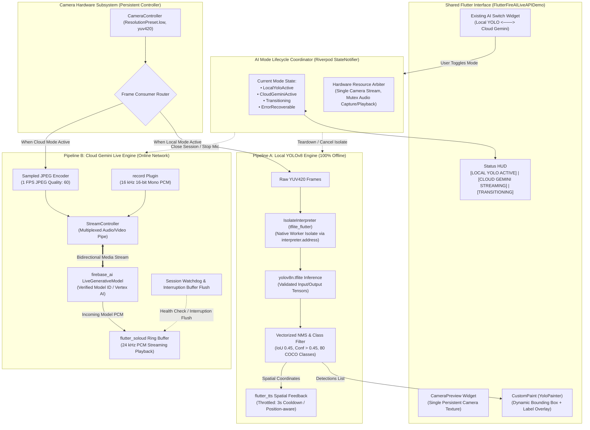
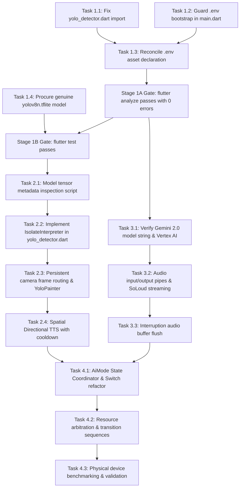

# CogniVision — Implementation Planning & Architecture Recovery Roadmap

**Document:** `docs/COGNIVISION_IMPLEMENTATION_PLAN.md`  
**Author:** Senior Flutter Engineer, Mobile Computer Vision Engineer, ML Inference Engineer & AI Systems Architect  
**Target Repository:** `d:\BattleStation\Projects\CogniVision`  
**Scope:** Flutter Mobile Application (`frontend/gemini_live_app`), On-Device Local YOLOv8n Object Detection, Cloud Gemini Live Multimodal Streaming, and AI Mode Switch Orchestration.  
**Operating Constraint:** Planning only. Zero destructive actions; zero unverified claims; no source code or configuration edits performed during this planning stage.

---

## Section A — Executive Summary

CogniVision is an assistive vision application designed to empower visually impaired users with real-time awareness of their physical environment. The mobile application provides a single, unified Flutter user interface with an **AI Mode Switch** that orchestrates two distinct, mutually exclusive computer vision and reasoning pipelines:

1. **Local YOLO Mode (Offline Edge AI):** Zero-latency, zero-network-dependency 2D obstacle detection running entirely on the mobile device. Detected obstacles (e.g., people, chairs, vehicles) are rendered via a live bounding-box HUD and announced through spatial Text-to-Speech (e.g., *"Person ahead"*, *"Chair on the left"*).
2. **Cloud Gemini Mode (Conversational Multimodal AI):** Low-latency, bidirectional audio/video streaming connecting camera frames and 16 kHz PCM microphone capture to Gemini 2.0 Flash via Firebase AI / Vertex AI Live API. Spoken scene descriptions and conversational answers are streamed back and played through low-latency PCM audio buffers.

### The Four-Phase Recovery Strategy

```
┌───────────────────────────────────────────────────────────────────────────────────────┐
│ Phase 1: Repository Recovery & Clean Compilation Baseline                             │
│ • Stage 1A (Source-Only Fixes):                                                       │
│   - Fix missing `foundation.dart` import in `yolo_detector.dart` (`debugPrint`)       │
│   - Reconcile `.env` asset declaration & make configuration truly optional            │
│   - Verify `flutter analyze` passes with 0 errors                                     │
│ • Stage 1B (Asset Bundle & Packaging):                                                │
│   - Procure & validate genuine YOLOv8n TFLite model                                   │
│   - Verify `flutter test` and Android build succeed                                   │
└──────────────────────────────────────────┬────────────────────────────────────────────┘
                                           │
┌──────────────────────────────────────────▼────────────────────────────────────────────┐
│ Phase 2: Genuine Local YOLOv8n Inference Pipeline                                     │
│ • Validate actual model tensor metadata (shape, type, quantization) before decoding   │
│ • Background inference using `tflite_flutter`'s native `IsolateInterpreter`           │
│ • Retain CameraController; route frames to YOLO without UI blocking                   │
│ • Connect live CameraPreview to CustomPainter bounding-box overlay                    │
│ • Spatial directional TTS with cooldown rate-limiting                                 │
└──────────────────────────────────────────┬────────────────────────────────────────────┘
                                           │
┌──────────────────────────────────────────▼────────────────────────────────────────────┐
│ Phase 3: Cloud Gemini Live Multimodal Integration                                     │
│ • Verify Gemini 2.0 Flash model identifier & Vertex AI project credentials            │
│ • Stream 16 kHz PCM microphone audio & sampled JPEG video frames                      │
│ • Stream incoming 24 kHz PCM audio chunks to `flutter_soloud` playback                │
│ • Harden session lifecycle (watchdog timer, speech interruption buffer flush)          │
└──────────────────────────────────────────┬────────────────────────────────────────────┘
                                           │
┌──────────────────────────────────────────▼────────────────────────────────────────────┐
│ Phase 4: AI Mode Switch & End-to-End Orchestration                                    │
│ • Preserve existing Switch widget as the single authoritative control                 │
│ • Formalize `AiMode` state coordinator (`localYolo` <──> `cloudGemini`)               │
│ • Enforce strict resource handover (single camera instance, exclusive audio routing) │
│ • Empirical physical Android hardware benchmarking (FPS, latency, thermal stability)  │
└───────────────────────────────────────────────────────────────────────────────────────┘
```

The backend server (`backend`), React web dashboard (`frontend/webapp`), and embedded Arduino tracking sketch (`location_service.ino`) are explicitly excluded from this recovery scope to focus all engineering effort on delivering a reliable mobile vision client.

---

## Section B — Current Repository State

Based on direct inspection of the codebase cross-referenced with the technical audit findings in [docs/COGNIVISION_AUDIT.md](file:///d:/BattleStation/Projects/CogniVision/docs/COGNIVISION_AUDIT.md), the repository's current status is as follows:

### 1. Verified Compilation & Asset Failures
- **Compilation Errors:** Running `flutter analyze` inside `frontend/gemini_live_app` produces 3 fatal errors in [yolo_detector.dart](file:///d:/BattleStation/Projects/CogniVision/frontend/gemini_live_app/lib/src/utilities/yolo_detector.dart) (lines 39, 41, and 135):
  `The method 'debugPrint' isn't defined for the type 'YoloDetector'.`
  *Root Cause:* Missing `import 'package:flutter/foundation.dart';`.
- **Asset Bundling Failure:** Running `flutter test` halts immediately:
  `Error detected in pubspec.yaml: No file or variants found for asset: assets/models/yolov8n.tflite.`
  *Root Cause:* [pubspec.yaml](file:///d:/BattleStation/Projects/CogniVision/frontend/gemini_live_app/pubspec.yaml#L53) explicitly declares `assets/models/yolov8n.tflite`, but the physical file does not exist on disk.
- **Runtime Startup Crash & `.env` Contradiction:** 
  - In [main.dart](file:///d:/BattleStation/Projects/CogniVision/frontend/gemini_live_app/lib/main.dart#L14):
    `await dotenv.load(fileName: ".env");`
  - In [pubspec.yaml](file:///d:/BattleStation/Projects/CogniVision/frontend/gemini_live_app/pubspec.yaml#L55):
    `- .env` is listed under `flutter.assets`.
  - In root [.gitignore](file:///d:/BattleStation/Projects/CogniVision/.gitignore#L57):
    `.env` is gitignored.
  - *Architectural Contradiction:* Declaring a gitignored file as a mandatory Flutter asset causes Flutter's asset packager to fail or warn if the developer does not possess an external `.env`. Furthermore, `flutter_dotenv` is used solely by GPS navigation ([navigation_service.dart:20](file:///d:/BattleStation/Projects/CogniVision/frontend/gemini_live_app/lib/src/gps_core/navigation_service.dart#L20), [user_home_screen.dart:39](file:///d:/BattleStation/Projects/CogniVision/frontend/gemini_live_app/lib/src/gps_features/user/user_home_screen.dart#L39)) and backend networking ([api_service.dart:10](file:///d:/BattleStation/Projects/CogniVision/frontend/gemini_live_app/lib/src/services/api_service.dart#L10), [socket_service.dart:16](file:///d:/BattleStation/Projects/CogniVision/frontend/gemini_live_app/lib/src/gps_core/socket_service.dart#L16)). **Local YOLO and camera vision have ZERO dependency on `.env`!** Creating an empty dummy `.env` merely masks the asset declaration bug.

### 2. Status of Existing YOLOv8 Implementation (Unverified Hypotheses)
- **Source File:** [lib/src/utilities/yolo_detector.dart](file:///d:/BattleStation/Projects/CogniVision/frontend/gemini_live_app/lib/src/utilities/yolo_detector.dart).
- **Label File:** [assets/models/yolov8n.txt](file:///d:/BattleStation/Projects/CogniVision/frontend/gemini_live_app/assets/models/yolov8n.txt) exists and contains all 80 standard COCO classes (0: `person` to 79: `toothbrush`).
- **Unverified Tensor Assumptions:** 
  - The current code assumes input shape `[1, 640, 640, 3]` Float32 (normalized `[0.0, 1.0]`) and output shape `[1, 84, 8400]` Float32.
  - *Risk:* No model artifact currently exists in the repository. The tensor shapes, channel strides `(4 + j) * 8400 + i`, quantization parameters, and output formats remain **unverified hypotheses** until a real model is inspected.
- **Main-Thread Bottleneck:**
  In [video_input.dart](file:///d:/BattleStation/Projects/CogniVision/frontend/gemini_live_app/lib/src/utilities/video_input.dart#L85-L119), each camera frame is converted from YUV420 to RGB via a pure-Dart loop on the UI thread, encoded to JPEG, throttled to 1 FPS (`now - _lastFrameTime < 1000`), and decoded back to bitmap in [yolo_detector.dart](file:///d:/BattleStation/Projects/CogniVision/frontend/gemini_live_app/lib/src/utilities/yolo_detector.dart#L50). This blocks the UI isolate for 300–600 ms per frame.

### 3. Background Inference & `tflite_flutter` Architecture
- **Version:** `tflite_flutter: ^0.12.1` ([pubspec.yaml:24](file:///d:/BattleStation/Projects/CogniVision/frontend/gemini_live_app/pubspec.yaml#L24)).
- **Native Pointer Isolation:** `Interpreter` holds a native C pointer (`Pointer<TfLiteInterpreter>`). Passing an active `Interpreter` instance across isolates via `Isolate.run()` or `compute()` is unsafe in Dart FFI and leads to native access violations.
- **Provided Solution:** `tflite_flutter 0.12.1` explicitly provides an internal `IsolateInterpreter` (`IsolateInterpreter.create(address: _interpreter.address)`). It spawns a background isolate that communicates via `SendPort`/`ReceivePort`, executing inference natively off the UI isolate. Resource disposal must strictly follow: `isolateInterpreter.close()` followed by `interpreter.close()`.

### 4. Status of Existing Gemini Live Implementation
- **Source File:** [lib/src/flutterfire_ai_live_api_demo.dart](file:///d:/BattleStation/Projects/CogniVision/frontend/gemini_live_app/lib/src/flutterfire_ai_live_api_demo.dart).
- **SDK & Provider:** Uses `firebase_ai: ^2.2.0` (`FirebaseAI.vertexAI().liveGenerativeModel(...)`).
- **Model Identifier:** `gemini-2.0-flash-exp` (line 28).
- **External Verification Status:** Unverified in runtime. Experimental Gemini endpoints are subject to deprecation by Google Cloud. Availability depends on the Firebase project having Vertex AI enabled with an active Blaze billing account.
- **Streaming Pipeline:** 
  - Mic: `AudioInput` ([audio_input.dart](file:///d:/BattleStation/Projects/CogniVision/frontend/gemini_live_app/lib/src/utilities/audio_input.dart)) streams 16 kHz 16-bit mono PCM.
  - Camera: `VideoInput` ([video_input.dart](file:///d:/BattleStation/Projects/CogniVision/frontend/gemini_live_app/lib/src/utilities/video_input.dart)) streams 1 FPS JPEG frames.
  - Output: `_session.receive()` pipes audio chunks to `flutter_soloud` ([audio_output.dart](file:///d:/BattleStation/Projects/CogniVision/frontend/gemini_live_app/lib/src/utilities/audio_output.dart)).
  - Flaw: Speech interruption (`response.interrupted == true`) only logs a message and does not flush the SoLoud buffer.

### 5. Detailed Inspection of the Existing Mode Switch
- **Location:** [lib/src/flutterfire_ai_live_api_demo.dart](file:///d:/BattleStation/Projects/CogniVision/frontend/gemini_live_app/lib/src/flutterfire_ai_live_api_demo.dart#L561-L571) (positioned at `bottom: 40, left: 30`).
- **Widget Implementation:** `_buildModeSwitch("YOLO", _isYoloMode, toggleYoloMode)` (lines 600–611) wrapping `Switch(value: value, onChanged: onChanged, activeColor: Color(0xFF20563F))`.
- **State Variable:** `bool _isYoloMode = false;` (line 54).
- **Callback:** `void toggleYoloMode(bool val) async` (lines 253–282).
- **Lifecycle & Synchronization Flaws:**
  1. *Binary Asymmetry:* When `_isYoloMode` is toggled OFF, `_yoloSubscription` is canceled, but the Gemini Live session is **never restarted**. The app drops into an "IDLE" limbo state.
  2. *Duplicate Inference Race Condition:* `startVideoStream()` (lines 224–236) has an un-awaited listener calling `_yoloDetector.detect(image)`. Meanwhile, `toggleYoloMode()` creates a second listener (`_yoloSubscription`). Two concurrent calls hit the single TFLite interpreter instance simultaneously.
  3. *Forced Auto-Connect at Boot:* [main_navigation_wrapper.dart:31](file:///d:/BattleStation/Projects/CogniVision/frontend/gemini_live_app/lib/src/screens/main_navigation_wrapper.dart#L31) auto-sets `vertexActiveProvider = true`, attempting to connect to Gemini Live immediately upon app launch.
  4. *Audio Collisions:* No audio mutex exists. Incoming Gemini audio and local YOLO TTS can play simultaneously.

---

## Section C — Target Architecture

The target architecture preserves the shared Flutter interface while replacing ad-hoc toggles with an **AI Mode Coordinator**.



### Architectural Guarantees
1. **Persistent Camera Hardware:** `CameraController` is initialized once and retained across mode switches. Only the downstream frame consumer (Isolate worker vs. JPEG sampler) is swapped.
2. **Offline Independence:** Local YOLO mode requires zero network access, zero Firebase tokens, and works in airplane mode.
3. **Safe Concurrency & Native Pointers:** Uses `IsolateInterpreter` from `tflite_flutter 0.12.1` rather than passing native pointers across `Isolate.run()`. Drops frames when inference is in flight.
4. **Mutually Exclusive Audio:** Microphone recording and SoLoud playback run exclusively in Cloud Gemini mode; Text-to-Speech runs exclusively in Local YOLO mode.

---

## Section D — Phase 1: Clean Compilation Baseline & Build Stages

### Stage 1A: Source-Only Compilation Fixes (Code-Only, Zero Model Weights Needed)
The goal of Stage 1A is to resolve all syntax and configuration inconsistencies so that `flutter analyze` passes cleanly with **0 errors**.

#### 1. Fix `yolo_detector.dart` Compilation Errors
- **File:** [frontend/gemini_live_app/lib/src/utilities/yolo_detector.dart](file:///d:/BattleStation/Projects/CogniVision/frontend/gemini_live_app/lib/src/utilities/yolo_detector.dart)
- **Problem:** `debugPrint` is undefined on lines 39, 41, and 135.
- **Exact Change:** Add `import 'package:flutter/foundation.dart';` at line 2.

#### 2. Reconcile `.env` Asset Declaration & Optional Configuration
- **File:** [frontend/gemini_live_app/pubspec.yaml](file:///d:/BattleStation/Projects/CogniVision/frontend/gemini_live_app/pubspec.yaml#L55)
- **Problem:** Listing `- .env` under `assets:` forces Flutter to require a gitignored file during packaging.
- **Exact Change:** Remove `- .env` from `pubspec.yaml` assets.
- **File:** [frontend/gemini_live_app/lib/main.dart](file:///d:/BattleStation/Projects/CogniVision/frontend/gemini_live_app/lib/main.dart#L14)
- **Problem:** `await dotenv.load(fileName: ".env");` throws unhandled exception when `.env` is absent.
- **Exact Change:** Guard loading so the app boots without `.env`:
  ```dart
  try {
    await dotenv.load(fileName: ".env");
  } catch (e) {
    debugPrint('[Bootstrap] Optional .env not loaded. Falling back to platform defaults.');
  }
  ```
- **File to Create:** `frontend/gemini_live_app/.env.example` as a documented template for developers configuring optional Google Maps or backend URLs.

#### Stage 1A Verification Command
```bash
flutter analyze
```
*Expected Outcome:* `flutter analyze` exits with code 0 (no compilation errors).

---

### Stage 1B: Asset Bundle & Test Packaging (Requires Real TFLite Model)
The goal of Stage 1B is to enable `flutter test` and native Android compilation.

#### 1. The Asset Bundling Gate
- `flutter test` and `flutter build apk` validate all assets declared in `pubspec.yaml`.
- Because `pubspec.yaml:53` declares `assets/models/yolov8n.tflite`, tests and builds will fail until a genuine TFLite model is placed at that path.

#### 2. Procure Genuine `yolov8n.tflite`
- Export or download official Ultralytics YOLOv8n Float32 model into `frontend/gemini_live_app/assets/models/yolov8n.tflite`.
- Ensure non-zero file size (~12–14 MB).

#### Stage 1B Verification Commands
```bash
flutter pub get
flutter test
flutter build apk --debug
```
*Expected Outcome:* `flutter test` passes unit tests; `flutter build apk --debug` packages the application successfully.

---

## Section E — Phase 2: Genuine Local YOLOv8n Inference Pipeline

### 2.1 Model Acquisition & Mandatory Pre-Decoder Validation Protocol
Because YOLOv8 exports can vary across tool versions (Float32 vs. INT8, transposed `[1, 8400, 84]` vs. standard `[1, 84, 8400]`), **the decoder implementation in `yolo_detector.dart` must not be modified until the actual model artifact is inspected.**

#### Model Validation Protocol (Execute via Python or Dart Inspection Script)
Before writing decoding logic, inspect the model:
```python
import tensorflow as tf
interpreter = tf.lite.Interpreter(model_path="assets/models/yolov8n.tflite")
interpreter.allocate_tensors()
input_details = interpreter.get_input_details()
output_details = interpreter.get_output_details()
print("INPUT:", input_details[0]['shape'], input_details[0]['dtype'])
print("OUTPUT:", output_details[0]['shape'], output_details[0]['dtype'])
```
**Decision Rules for Decoder Adaptation:**
- If Output Shape is `[1, 84, 8400]`: Stride indexing is `(4 + class_idx) * 8400 + anchor_idx`.
- If Output Shape is `[1, 8400, 84]`: Stride indexing is `anchor_idx * 84 + (4 + class_idx)`.
- If Datatype is `uint8`/`int8`: Apply quantization scale and zero-point: `val = (quantized - zero_point) * scale`.
- If Datatype is `float32`: Normalization is standard `pixel / 255.0`.

### 2.2 Background Inference via `IsolateInterpreter` (`tflite_flutter 0.12.1`)
- **Native Isolate Creation:**
  In `yolo_detector.dart`:
  ```dart
  _interpreter = await Interpreter.fromAsset('assets/models/yolov8n.tflite');
  _isolateInterpreter = await IsolateInterpreter.create(address: _interpreter!.address);
  ```
- **Non-blocking Execution:**
  ```dart
  if (_isProcessing || _isolateInterpreter == null) return [];
  _isProcessing = true;
  try {
    await _isolateInterpreter!.run(inputBuffer, outputBuffer);
  } finally {
    _isProcessing = false;
  }
  ```
- **Strict Disposal Lifecycle:**
  ```dart
  Future<void> dispose() async {
    await _isolateInterpreter?.close(); // Terminates background isolate
    _interpreter?.close();              // Deallocates native C pointer
  }
  ```

### 2.3 Camera Integration & Persistent Controller
- Maintain the single `CameraController` instance across modes.
- In Local YOLO mode, hook the camera stream directly into the background isolate's input buffer.
- Map normalized bounding box coordinates (`[cx, cy, w, h]`) to screen space inside `YoloPainter`, accounting for `BoxFit.cover` aspect-ratio scaling.

### 2.4 Spatial Directional Text-to-Speech (TTS)
- Rate-limit announcements in `tts_service.dart`: Add a `DateTime _lastSpokenTime` tracking a 3-second cooldown.
- Spatial orientation:
  - `centerX < 0.33` → *"on your left"*
  - `centerX > 0.66` → *"on your right"*
  - `0.33 <= centerX <= 0.66` → *"ahead"*

### 2.5 Measurable Performance Targets (To Be Empirically Benchmarked)
- **Camera Preview FPS:** Target ≥ 24 FPS (no UI freeze).
- **Inference Latency:** Target < 250 ms on mid-tier physical Android hardware (API 24+).
- **Memory Footprint:** Resident memory stable (< 350 MB) over 10 minutes of continuous inference.

### Phase 2 Acceptance Criteria
- Verified model metadata matches decoder indexing.
- Real physical objects (person, chair, bottle) detected with confidence > 50%.
- Bounding boxes tightly track detected objects on camera screen.
- Works 100% offline in Airplane Mode.

---

## Section F — Phase 3: Cloud Gemini Live Multimodal Integration

### 3.1 Model & Provider Verification Protocol
- **Current Model Identifier:** `gemini-2.0-flash-exp` ([flutterfire_ai_live_api_demo.dart:28](file:///d:/BattleStation/Projects/CogniVision/frontend/gemini_live_app/lib/src/flutterfire_ai_live_api_demo.dart#L28)).
- **External Verification Requirement:**
  1. Confirm that the Google Cloud project associated with `google-services.json` has **Vertex AI in Firebase** enabled with Blaze billing.
  2. Verify if `gemini-2.0-flash-exp` is active in the project's region. If deprecated by Google, update to the stable production string `gemini-2.0-flash`.
  3. Keep the existing `firebase_ai: ^2.2.0` architecture; make model string configurable via a constant in `providers.dart`.

### 3.2 Media Streaming & Audio Management
- **Microphone Stream:** Continuous 16 kHz 16-bit mono PCM stream via `AudioInput`.
- **Camera Frame Stream:** Sampled 1 FPS JPEG stream (quality 60) via `VideoInput`.
- **Audio Output:** Stream incoming audio chunks to `AudioOutput` (`flutter_soloud`).
- **Interruption Buffer Flush:** When `response.interrupted == true` is received in `_handleLiveServerMessage()`, immediately clear the SoLoud audio buffer to stop obsolete audio playback.

### Phase 3 Acceptance Criteria
- Live session successfully connects when network and Firebase credentials are present.
- Spoken queries about the visual scene receive coherent, natural-language spoken answers.
- User interruption stops playback immediately.
- Network disconnection displays an actionable error HUD without crashing.

---

## Section G — Phase 4: Mode Switch & End-to-End Orchestration

### 4.1 Preserve Existing Switch as Single Control
- Keep the existing Switch at [flutterfire_ai_live_api_demo.dart:561-571](file:///d:/BattleStation/Projects/CogniVision/frontend/gemini_live_app/lib/src/flutterfire_ai_live_api_demo.dart#L561-L571).
- Replace `bool _isYoloMode` with a formal state enum:
  ```dart
  enum AiMode { localYolo, cloudGemini }
  enum TransitionState { idle, transitioning, active, error }
  ```

### 4.2 Safe Lifecycle Handover Sequences

#### Transition 1: Switching from Cloud Gemini to Local YOLO
1. UI switch tapped → Set state to `TransitionState.transitioning`. Disable switch interactions.
2. Cloud Teardown:
   - Cancel `_sessionWatchdog` timer.
   - Close `_combinedMediaController`.
   - Stop mic recording (`AudioInput.stopRecording()`).
   - Stop and flush SoLoud audio stream (`AudioOutput.stopStream()`).
   - Close LiveSession (`_session.close()`).
3. Local Setup:
   - Initialize `YoloDetector` and background `IsolateInterpreter`.
   - Initialize `TtsService`.
   - Direct camera frame stream to YOLO worker isolate.
4. Transition Complete: Set mode to `AiMode.localYolo`, status to `TransitionState.active`. Update HUD to `LOCAL YOLO ACTIVE`.

#### Transition 2: Switching from Local YOLO to Cloud Gemini
1. UI switch tapped → Set state to `TransitionState.transitioning`. Disable switch interactions.
2. Local Teardown:
   - Detach camera frame listener from YOLO isolate worker.
   - Clear active detections list `_detections = []`.
   - Stop any active TTS speech (`TtsService.stop()`).
3. Cloud Setup:
   - Verify network connectivity. If offline, display error HUD: *"Internet required for Cloud Gemini. Staying in Local YOLO"* and revert switch.
   - Initialize SoLoud audio stream.
   - Connect `LiveGenerativeModel`.
   - Start mic PCM recording and camera JPEG sampler into unified pipe.
   - Start session watchdog timer.
4. Transition Complete: Set mode to `AiMode.cloudGemini`, status to `TransitionState.active`. Update HUD to `CLOUD GEMINI STREAMING`.

### 4.3 Hardware Resource Matrix

| Hardware Resource | Local YOLO Mode | Cloud Gemini Mode | Transitioning State |
|---|---|---|---|
| **Camera Sensor** | Active (Frames to Isolate) | Active (Sampled 1 FPS JPEG) | Kept Alive (Zero sensor re-init) |
| **Microphone** | **Completely Released** | Active (16 kHz PCM) | Stopped |
| **Text-to-Speech** | Active (Spatial object alerts)| **Completely Muted** | Stopped |
| **SoLoud Audio** | **Idle** | Active (24 kHz PCM stream) | Flushed |
| **Network (Wi-Fi/LTE)**| **Zero requests** | Bidirectional streaming | Cleanly closed |

### Phase 4 Acceptance Criteria
- Toggling modes transitions cleanly without crashing or leaking isolates/sessions.
- Camera preview stays continuous without flashing black.
- Offline mode cleanly stays in or falls back to Local YOLO.
- Both modes verified on physical Android hardware.

---

## Section H — Complete Dependency Graph



---

## Section I — Detailed Task Checklist

### Phase 1: Repository Recovery & Clean Compilation Baseline

- [ ] **Task 1.1 — Fix `yolo_detector.dart` Compilation Errors (Stage 1A)**
  - **Phase:** 1 | **Priority:** Blocker
  - **Files:** `frontend/gemini_live_app/lib/src/utilities/yolo_detector.dart`
  - **Problem:** `debugPrint` is undefined on lines 39, 41, 135.
  - **Exact Changes:** Add `import 'package:flutter/foundation.dart';` at line 2.
  - **Dependencies:** None.
  - **Verification:** `flutter analyze lib/src/utilities/yolo_detector.dart` outputs 0 errors.

- [ ] **Task 1.2 — Guard `.env` Bootstrap Loading in `main.dart` (Stage 1A)**
  - **Phase:** 1 | **Priority:** Critical
  - **Files:** `frontend/gemini_live_app/lib/main.dart`
  - **Problem:** `dotenv.load()` throws unhandled exception if `.env` is missing.
  - **Exact Changes:** Wrap `dotenv.load()` in a `try/catch` block.
  - **Dependencies:** None.
  - **Verification:** App boots without `.env` file present on disk.

- [ ] **Task 1.3 — Reconcile `.env` Asset Declaration in `pubspec.yaml` (Stage 1A)**
  - **Phase:** 1 | **Priority:** Critical
  - **Files:** `frontend/gemini_live_app/pubspec.yaml`, `frontend/gemini_live_app/.env.example`
  - **Problem:** Declaring a gitignored file as a mandatory asset creates build failures.
  - **Exact Changes:** Remove `- .env` from `pubspec.yaml` assets. Create `.env.example` as a template.
  - **Dependencies:** Task 1.2.
  - **Verification:** `flutter analyze` runs without `.env` asset warnings.

- [ ] **Task 1.4 — Procure Genuine `yolov8n.tflite` Asset (Stage 1B)**
  - **Phase:** 1 | **Priority:** Blocker
  - **Files:** `frontend/gemini_live_app/assets/models/yolov8n.tflite`
  - **Problem:** Missing model asset crashes `flutter test` asset bundler.
  - **Exact Changes:** Procure verified YOLOv8n Float32 TFLite model (~12–14 MB) and place in `assets/models/`.
  - **Dependencies:** Stage 1A complete.
  - **Verification:** `flutter test` completes and passes existing tests.

---

### Phase 2: Genuine Local YOLOv8n Inference Pipeline

- [ ] **Task 2.1 — Model Tensor Shape & Metadata Validation Protocol**
  - **Phase:** 2 | **Priority:** High
  - **Files:** `assets/models/yolov8n.tflite`
  - **Problem:** Decoder math will crash or output garbage if tensor layout does not match code assumptions.
  - **Exact Changes:** Run tensor inspection script to verify input shape, output shape (`[1, 84, 8400]` vs `[1, 8400, 84]`), and datatype (Float32 vs INT8).
  - **Dependencies:** Task 1.4.
  - **Verification:** Document verified tensor shapes and align `yolo_detector.dart` index math.

- [ ] **Task 2.2 — Background Inference via `IsolateInterpreter`**
  - **Phase:** 2 | **Priority:** High
  - **Files:** `lib/src/utilities/yolo_detector.dart`
  - **Problem:** UI isolate blocking; native pointers cannot cross `Isolate.run()`.
  - **Exact Changes:** Implement `IsolateInterpreter.create(address: _interpreter.address)` from `tflite_flutter 0.12.1`. Implement disposal sequence (`isolateInterpreter.close()` then `interpreter.close()`).
  - **Dependencies:** Task 2.1.
  - **Verification:** UI thread remains responsive during active detection.

- [ ] **Task 2.3 — Persistent Camera Frame Routing & Bounding Box HUD**
  - **Phase:** 2 | **Priority:** Medium
  - **Files:** `lib/src/utilities/video_input.dart`, `lib/src/flutterfire_ai_live_api_demo.dart` (`YoloPainter`)
  - **Problem:** Camera preview scaling displacement and stream conflicts.
  - **Exact Changes:** Retain camera controller; route raw frames to YOLO isolate worker; scale normalized coordinates to canvas using fitted aspect ratio.
  - **Dependencies:** Task 2.2.
  - **Verification:** Bounding boxes tightly track real objects on physical camera view.

- [ ] **Task 2.4 — Directional Spatial TTS with Cooldown**
  - **Phase:** 2 | **Priority:** Medium
  - **Files:** `lib/src/services/tts_service.dart`
  - **Problem:** Continuous speech stuttering without cooldown.
  - **Exact Changes:** Add 3-second announcement cooldown and change-detection filter.
  - **Dependencies:** Task 2.3.
  - **Verification:** TTS speaks detected object and direction once every 3 seconds.

---

### Phase 3: Cloud Gemini Live Multimodal Integration

- [ ] **Task 3.1 — Verify Gemini 2.0 Model String & Vertex AI Compatibility**
  - **Phase:** 3 | **Priority:** High
  - **Files:** `lib/src/flutterfire_ai_live_api_demo.dart`
  - **Problem:** Deprecated experimental model strings cause 404 connection failures.
  - **Exact Changes:** Confirm active model string (`gemini-2.0-flash-exp` vs `gemini-2.0-flash`) in Google Cloud Console.
  - **Dependencies:** Stage 1A complete.
  - **Verification:** Gemini session connects successfully in test run.

- [ ] **Task 3.2 — Media Streaming Pipes & SoLoud Audio Playback**
  - **Phase:** 3 | **Priority:** High
  - **Files:** `lib/src/utilities/audio_input.dart`, `lib/src/utilities/video_input.dart`, `lib/src/utilities/audio_output.dart`
  - **Problem:** Synchronizing 16 kHz PCM microphone capture and 1 FPS JPEG camera frames.
  - **Exact Changes:** Route mic and camera frames into `_combinedMediaController`; pipe incoming chunks to `flutter_soloud`.
  - **Dependencies:** Task 3.1.
  - **Verification:** Two-way audio-visual dialogue functions on physical device.

- [ ] **Task 3.3 — Implement Speech Interruption Audio Flush**
  - **Phase:** 3 | **Priority:** Medium
  - **Files:** `lib/src/flutterfire_ai_live_api_demo.dart`, `lib/src/utilities/audio_output.dart`
  - **Problem:** Model voice keeps talking over user speech.
  - **Exact Changes:** When `response.interrupted == true`, flush SoLoud buffer.
  - **Dependencies:** Task 3.2.
  - **Verification:** Speaking while model is answering immediately cuts off audio playback.

---

### Phase 4: Mode Switch & End-to-End Orchestration

- [ ] **Task 4.1 — Implement `AiMode` State Coordinator**
  - **Phase:** 4 | **Priority:** High
  - **Files:** `lib/src/providers.dart`, `lib/src/flutterfire_ai_live_api_demo.dart`
  - **Problem:** Boolean `_isYoloMode` leaves app in idle limbo on switch-off.
  - **Exact Changes:** Implement formal state machine managing `AiMode.localYolo` vs `AiMode.cloudGemini`.
  - **Dependencies:** Tasks 2.4 and 3.3.
  - **Verification:** Mode state transitions predictably with informative logging.

- [ ] **Task 4.2 — Implement Safe Lifecycle Handover Sequences**
  - **Phase:** 4 | **Priority:** Critical
  - **Files:** `lib/src/flutterfire_ai_live_api_demo.dart`
  - **Problem:** Competing mic capture, overlapping audio, and zombie background streams.
  - **Exact Changes:** Enforce full teardown of outgoing pipeline before starting incoming pipeline. Keep camera controller persistent.
  - **Dependencies:** Task 4.1.
  - **Verification:** Switching between modes leaves zero leaked isolates or active sessions.

- [ ] **Task 4.3 — Physical Android Hardware Benchmarking**
  - **Phase:** 4 | **Priority:** High
  - **Files:** Entire Flutter app
  - **Problem:** Validating real-world performance claims.
  - **Verification:** Measure and record preview FPS, inference latency (ms), and mode-switch transition time on physical device.

---

## Section J — Environment and Model Prerequisites

### For Local YOLO Mode (Zero Cloud Requirements)
- **Model Asset:** `frontend/gemini_live_app/assets/models/yolov8n.tflite` (~12–14 MB).
- **Label File:** `frontend/gemini_live_app/assets/models/yolov8n.txt` (80 COCO classes).
- **Device Capabilities:** Android physical device running Android 7.0+ (API 24+) with back camera.
- **Network Requirement:** **None. Fully functional in Airplane Mode.**

### For Cloud Gemini Mode (Online Network Requirements)
- **Firebase Project:** Active project with Blaze (pay-as-you-go) plan enabled.
- **Service Enablement:** **Vertex AI in Firebase** enabled in the Firebase Console.
- **Configuration File:** Valid `frontend/gemini_live_app/android/app/google-services.json` registered to `com.anudeep.vision_aid_app`.
- **Network Requirement:** Active Wi-Fi or cellular internet connection.

---

## Section K — Definition of Done

| Phase | Milestone | Verifiable Definition of Done |
|---|---|---|
| **Phase 1** | Compilation Baseline | Stage 1A: `flutter analyze` returns 0 errors without `.env` on disk.<br>Stage 1B: `flutter test` and `flutter build apk --debug` succeed with genuine `yolov8n.tflite`. |
| **Phase 2** | Local YOLO Inference | Verified model tensors match decoder; real COCO objects detected with > 50% confidence; spatial TTS announces obstacles; works in Airplane Mode. |
| **Phase 3** | Cloud Gemini Live | Bidirectional Live session established; mic audio and camera frames stream to Gemini; spoken responses play via SoLoud; speech interruption flushes audio. |
| **Phase 4** | Mode Switch & Orchestration | Existing switch transitions between Local YOLO and Cloud Gemini cleanly; camera controller retained; zero leaked streams; latency/FPS empirically measured on hardware. |

---

## Section L — Decisions and Unresolved Questions

1. **Decoder Alignment Decision:**
   - *Policy:* Do not touch `yolo_detector.dart` index math until Task 2.1 inspection confirms whether the exported model outputs `[1, 84, 8400]` or `[1, 8400, 84]`.
2. **Camera Stream Sharing:**
   - *Policy:* Retain a single persistent `CameraController` across the app lifecycle. Do not call `dispose()` or re-initialize native camera hardware during mode switching; dynamically redirect frames to the active consumer.
3. **External Model String Verification:**
   - *Unverified Item:* Whether Google Cloud Vertex AI in the user's project currently serves `gemini-2.0-flash-exp` or requires `gemini-2.0-flash`. Must be verified against the live Google Cloud Console during Phase 3.

---

## Section M — Recommended First Implementation Task

> [!IMPORTANT]
> **Task 1.1 + 1.2 + 1.3: Stage 1A Source-Only Compilation & Asset Reconciliation**  
> *(Planning only — do not execute now)*

### Exactly What to Modify
1. In [lib/src/utilities/yolo_detector.dart](file:///d:/BattleStation/Projects/CogniVision/frontend/gemini_live_app/lib/src/utilities/yolo_detector.dart#L2): Add `import 'package:flutter/foundation.dart';`.
2. In [lib/main.dart](file:///d:/BattleStation/Projects/CogniVision/frontend/gemini_live_app/lib/main.dart#L14): Wrap `await dotenv.load(fileName: ".env");` in a `try/catch` block.
3. In [pubspec.yaml](file:///d:/BattleStation/Projects/CogniVision/frontend/gemini_live_app/pubspec.yaml#L55): Remove `- .env` from `assets:`.
4. Create `frontend/gemini_live_app/.env.example` as a documented template.

### Why This Precedes Everything Else
This task is strictly source-code-only and requires zero external model files or cloud credentials. It eliminates the 3 fatal compilation errors and the `.env` asset warning, allowing `flutter analyze` to pass cleanly with **0 errors** and establishing a verified code baseline before introducing model binaries.
